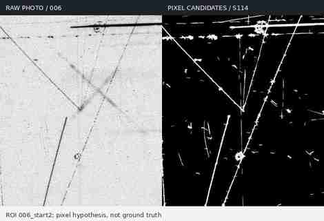
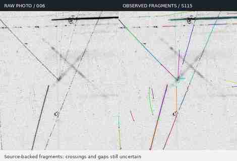
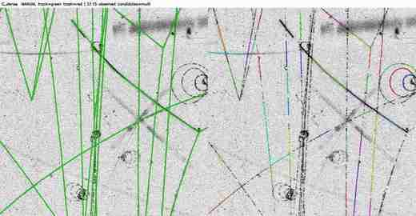
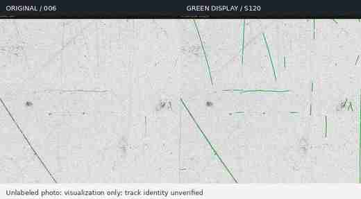
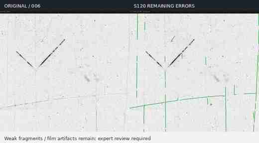
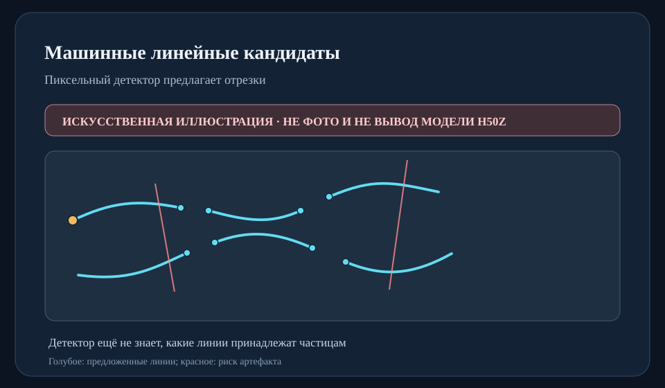
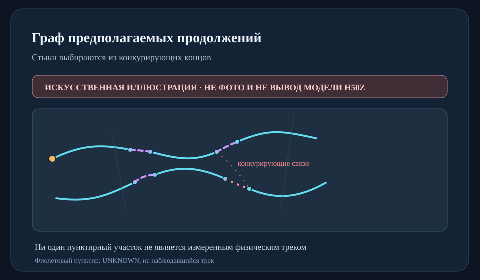

# ANZA–LIRA / Bubble Chamber — выделение и связывание треков

**Текущая рабочая ветка:** `research/bubble-chamber-graph-lira` · **Состояние:** 11 ноября 2026 года, S114–S122.  
**Цель:** получить из исходного скана пузырьковой камеры проверяемые геометрические кандидаты траекторий и предложить объединения разорванных наблюдаемых участков. Это **не** готовая идентификация частиц и **не** физически аттестованная разметка.

> Для команды физиков: этот README описывает, почему ушли от одной попиксельной сегментации, как сейчас алгоритм находит фрагменты и восстанавливает продолжения, чем проверяли качество на `H50Z_030_01_007.bmp` и `006.bmp`, как самостоятельно запустить его на своих BMP и как выбрать **20 участков для экспертного контроля**. Все полные сканы, исходные ручные метки и обученные локальные модели должны оставаться вне публичного репозитория.

## 1. Как менялся подход

### Сначала — сегментация пикселей

Первые прототипы искали «пиксель принадлежит треку / не принадлежит», пробовали пороговую и ориентированную фильтрацию, скелетизацию и ANZA-подобные сегментационные модели. Такой подход естественен, но на архивных фотографиях плохо решает задачу *идентичности целой кривой*: одна линия распадается на множество островков, близкие линии слипаются в местах пересечений, а кресты, царапины и метки аппарата выглядят как треки. Большой надёжной попиксельной разметки для обучения и независимой проверки у нас не было.

На иллюстрации **именно исходный пиксельный кандидат S114**, а не выдача обученной нейросети и не «истинная» маска. Он хорошо показывает ограничение бинарного слоя.



**Вывод:** лучше не требовать, чтобы сегментация сразу построила полный физический трек. Она должна поставлять *локально найденные опорные участки*, для которых потом отдельно решается связность.

### Затем — от пиксельных островков к опорным точкам и кривым

Мы ориентировались на практику ручной разметки: эксперт видит фрагменты одной линии, прослеживает её форму через слабые места и сохраняет принадлежность к одному объекту даже при заметном пропуске. Программа теперь сначала извлекает реально наблюдаемые центральные линии, их упорядоченные точки и локальные направления. По ним строятся **параметрические гладкие кривые**, а между подходящими концами — гипотезы продолжения. Это не «функция только по началу и концу»: одних двух концов недостаточно для спирали или пересечения; нужны все опорные точки, касательные, кривизна и свидетельства на исходной фотографии.



Здесь видна и нерешённая часть: не все слабые спиральные дуги и не все длинные участки уже обнаружены. Нельзя «дорисовать» их и назвать наблюдаемыми.

### Одна частично размеченная фотография помогла проверить, а не научить всему

В `H50Z_030_01_007.bmp` есть отдельная ручная JSON-разметка: 78 записей `track`, из них 74 с непустыми штрихами, и 45 записей `trash`, из них 44 непустые. Это **частичная** разметка, не полная карта всех треков и не подтверждённая классификация частиц. Она применялась для оценки найденных линий, разбора ложных объединений и обучения *вспомогательного* фильтра S120, но не для достраивания GT-пикселей в S114/S115/S121.



Неразмеченный `006` используется для проверки переносимости и визуальных ошибок. Он из той же серии H50Z, а не независимого другого эксперимента. На нём нет правильных ответов о том, какие именно линии истинные.

## 2. Что сейчас делает ANZA–LIRA, по этапам

```text
Исходный BMP (8-bit, неизменённые пиксели, SHA-256)
    │
    ▼
S114: направленные отклики → пиксельные кандидаты → скелет
    │
    ▼
S115: граф наблюдаемых линий, ветвления и пересечения
      → упорядоченные точки каждого фрагмента → кривые/касательные
    │
    ▼
S117: осторожные локальные ассоциации разорванных фрагментов
      (фото + касательная + форма + конкурирующие продолжения)
    │
    ▼
S118: сшивка дублирующихся кривых на перекрытиях плиток
      → глобальные, но всё ещё предварительные ID
    │
    ├──── S120: отдельная оценка «похоже на трек или артефакт»
    │            → зелёный / спорный / не показывать в основном слое
    ▼
S119/S121: многомасштабная проверка направления +
           осторожные длинные продолжения между группами
    │
    ▼
JSON: исходные наблюдения, ID групп, связи, риски, происхождение
JPG/CSV: визуальная проверка физиками и независимые решения
```

**Важно про название.** Здесь «ANZA–LIRA» — название исследовательской ветки и направления. В актуальном воспроизводимом S114–S121 обработчике используются **OpenCV/NumPy/SciPy, правила для графа и локальный RandomForest для фильтра S120**. Это **не означает**, что на этих полных кадрах уже обучена и подтверждена сквозная нейросеть ANZA + Graph-LIRA. Нейросетевой этап остаётся следующим исследовательским шагом после экспертной верификации.

#### S114 — источник опорных пикселей

Скан делится на перекрывающиеся области, например 2000×2000 пикселей с перекрытием 250. На каждой области строится ответ на тонкие ориентированные тёмные структуры; получается маска кандидатов и скелет, где сохраняется связь с координатами *оригинального BMP*. Кресты и технические маркировки должны быть исключены отдельной защищённой маской, если она доступна. **Не надо нормализованную PNG-превью выдавать за исходный BMP.**

#### S115 — геометрические фрагменты, а не россыпь несвязанных точек

Из скелета выделяются упорядоченные центральные линии и граф их пересечений. У каждого кандидата сохраняются `candidate_id`, `observed_pixel_path_xy`, `spline_xy`, локальные концы, длина и происхождение. Сплайн задаётся точками на реальном фрагменте. Порядок имеет значение: для разных ветвей пересечения нельзя автоматически назначать один ID лишь потому, что пиксели касаются.

#### S117 и S121 — как решается вопрос «это один трек?»

Для фрагментов с концами \(p_a, p_b\) и направленными наружу касательными \(t_a, t_b\) строится **кандидат соединения**, а не новый обнаруженный трек. Проверяются согласование касательных с вектором между концами, кривизна интерполяции, отсутствие опасного бокового скачка на соседнюю параллельную линию, наличие фотометрического сигнала по предполагаемому коридору, близкие соперничающие линии, взаимно лучший вариант и глобальная непротиворечивость. Длинный разрыв допустим **только при достаточной поддержке**, не «просто если линии продолжаются примерно по прямой».

Технически используется локальная гладкая **кубическая интерполяция Безье/Эрмита** по точкам и касательным, а не одна глобальная парабола: такая форма позволяет описать плавные дуги и часть спиралей без резкого угла между кусками. Пример локального сегмента: \(B(t)=(1-t)^3P_0+3(1-t)^2tP_1+3(1-t)t^2P_2+t^3P_3\). Спирали и сильно криволинейные пропуски **по-прежнему остаются сложным случаем**; система не восстанавливает их гарантированно.

Каждая связь хранит `inferred_geometry_only=true`, `source_observed_bridge_pixels=0` и решение `AUTO_PROVISIONAL_CONTINUATION_NOT_GT` либо `REVIEW_ONLY_*`. Один и тот же конец не должен автоматически соединяться с двумя разными кривыми; циклы и пересечения предполагаемых связей ограничиваются.

#### S118 — полное изображение и единые ID поверх разных плиток

Перекрывающиеся области видят один и тот же участок несколько раз. S118 сопоставляет эти *дубликаты наблюдений* по пикселям, координатам и геометрии и формирует `global_group_id` с перечнем `source_curve_keys`. Это уменьшает искусственное количество объектов из-за плиточной сетки. Восстановление ID не означает восстановления невидимых пикселей. Выдача сохраняет исходную геометрию и позволяет вернуться к отдельным фрагментам.

#### S120 — убираем лишнее из основного просмотра, но не из исходников

По длине, форме, кривизне и поперечному контрасту наблюдаемой линии на **оригинальном BMP** вспомогательный классификатор оценивает, что больше похоже на трек, а что — на метку или царапину. Цветовая схема просмотра:

- **Зелёный:** предварительно распознанные трекоподобные сегменты. **Все зелёные визуально одинаковы, но каждый объект сохраняет собственный ID.**
- **Жёлто-оранжевый:** спорные сегменты, которые нужно проверить.
- **Оранжевый пунктир:** *предполагаемые* соединения, а не исходно увиденные пиксели.
- **Не показывать в основном слое:** подозрительные короткие/паразитные линии, которые **не удаляются** из подробного JSON и могут быть возвращены.



S120 обучен по частичным штрихам `007`. Его оценка **не** калиброванная вероятность частицы, и на `006` корректной метрики распознавания нет.



## 3. Что измерено на настоящих сканах

| Проверка | Размеченный `007` | Неразмеченный `006` |
|---|---:|---:|
| Полный размер, px | 9103×26317 | 9268×25324 |
| Обработано плиток 2000×2000 | 90/90 | 90/90 |
| Экземпляров обнаруженных кривых S115 | 6 928 | 5 332 |
| Групп после безопасного S118 | 3 466 | 2 697 |
| Новых осторожных ассоциаций S121 | 92 | 59 |
| Итоговых **предварительных** групп S121 | 3 374 | 2 638 |
| Доказанных физических треков | **нет такой оценки** | **нет такой оценки** |

На `007` доля центральных точек **размеченных** трековых штрихов, рядом с которыми есть найденная геометрия S114/S115 (±5 px), составила **64,04%**. Для размеченного мусора аналогичная величина была **78,92%**, то есть в ранней выдаче много лишнего. После финального S120-подсвечивания получено **62,08%** по штрихам `track` и **0,68%** по штрихам `trash` в той же процедуре. **Оценка на изображении, использованном для обучения S120, оптимистична и не является независимым precision/recall/F1.** Групповая кросс-валидация по ручным штрихам дала OOF AUROC 0,9545 **внутри одного кадра**, но не проверяет другой фильм/эксперимент.

Среди новых осторожных связей S121 в `007` 31 согласована с двумя уверенными ручными ID, новых противоречий в этой части аудита не обнаружено, но **два старых рискованных объединения S117/S118 остаются** (ручные пары `48/122` и `57/99`). На `006` без ручных трековых масок утверждать аналогичную точность нельзя. На обоих снимках пропускаются слабые линии и фрагменты спиралей; метки/царапины всё ещё дают ложные срабатывания.

Итог: сейчас можно **получить кандидаты, наложения и список спорных связей для экспертного просмотра**, но нельзя автоматически считать частицы, реконструировать импульс или оценивать ионизацию как подтверждённую величину.

## 4. Как воспроизвести у физиков

Все команды ниже выполняются из корня репозитория, на машине с доступом к приватным исходным BMP. Сами BMP в GitHub не загружаются. Требуется Python 3.11+; текущий S114–S121 конвейер — **CPU-режим**, GPU для него не обязателен.

```bash
python -m venv .venv
source .venv/bin/activate
python -m pip install -r requirements_s121.txt

# Полный BMP. Данные и промежуточные файлы — только в PRIVATE.
PYTHONPATH=. OPENBLAS_NUM_THREADS=1 python scripts/research/bubble_chamber/run_s118_full_bmp.py \
  --bmp /PRIVATE/H50Z_030_01_006.bmp \
  --out /PRIVATE/results/S118_006 \
  --tile-size 2000 --overlap 250

# Предварительные дальние продолжения по оригинальной фотографии.
PYTHONPATH=. OPENBLAS_NUM_THREADS=1 python scripts/research/bubble_chamber/run_s121_fullframe.py \
  --bmp /PRIVATE/H50Z_030_01_006.bmp \
  --run-dir /PRIVATE/results/S118_006 \
  --out /PRIVATE/results/S121_006.json
```

Скрипт S118 сохраняет `RUN_CONFIG.json`, `S118_MANIFEST_00090.json`, локальные `S115_CURVES.json` / `S117_GROUPS.json`, `S118_STITCH_00090/S118_STITCH_NOT_GT.json`. Перезапуск **только с теми же SHA источника и параметрами** с флагом `--resume`; исходные кривые не переписываются. В случае иного размера снимка количество плиток в имени выходных файлов будет другим.

**Для зелёного слоя S120** нужна заранее обученная у нас локальная модель; она **не прилагается к публичной ветке**. Только доверенную локальную модель формата `joblib` можно загружать: формат основан на pickle. Чтобы обучить свою, сначала соберите в закрытом каталоге ручные штрихи `track/trash`, отдельно выполните 
`s120_extract_features.py` и `train_s120_quality.py`. Для нового BMP без разметки:

```bash
PYTHONPATH=. python scripts/research/bubble_chamber/s120_extract_features.py \
  --bmp /PRIVATE/H50Z_030_01_006.bmp \
  --run-dir /PRIVATE/results/S118_006 \
  --out /PRIVATE/results/features_006.npz
PYTHONPATH=. python scripts/research/bubble_chamber/run_s120_review.py \
  --bmp /PRIVATE/H50Z_030_01_006.bmp \
  --run-dir /PRIVATE/results/S118_006 \
  --features /PRIVATE/results/features_006.npz \
  --model /PRIVATE/models/TRUSTED_S120_model.joblib \
  --out /PRIVATE/results/S120_006
```

Все числа и названия форматов на этом этапе описывают **кандидатов**, не GT.

## 5. Сначала 20 участков, а не сразу доверять всему снимку

Код для команды физиков: [`make_s122_20_roi_review.py`](scripts/research/bubble_chamber/make_s122_20_roi_review.py). Он:

1. Проверяет, что SHA исходного BMP точно совпадает с исходником S118 и весь кадр обработан.
2. Выбирает **20 непересекающихся по сетке зон** по всей высоте и ширине снимка (4 колонки × 5 строк, размер по умолчанию 1024×1024, небольшой детерминированный сдвиг с фиксированным seed). Зоны выбираются **до просмотра результата** — нельзя взять только красивые примеры.
3. Делает для каждой зоны компактную пару `оригинал / зелёные наблюдаемые линии + спорные линии + предположительные связи`. Связи S121 выделяются пунктиром, настоящими наблюдениями не называются.
4. Создаёт `REVIEW_20_REGIONS.csv` с исходными XY-координатами и колонками для мнения экспертов. Рядом `SOURCE_AND_REVIEW_INFO.json` для воспроизведения.

```bash
PYTHONPATH=. python scripts/research/bubble_chamber/make_s122_20_roi_review.py \
  --bmp /PRIVATE/H50Z_030_01_006.bmp \
  --run-dir /PRIVATE/results/S118_006 \
  --s120-status /PRIVATE/results/S120_006/S120_GROUP_STATUS.json \
  --s121 /PRIVATE/results/S121_006.json \
  --out /PRIVATE/review_006_20_rois \
  --roi-size 1024 --seed 20261111
```

Если S120-модели нет, **не подставлять выдуманные веса**: запустите без `--s120-status`. Тогда покажутся все найденные S115-кандидаты одним зелёным цветом, и протокол будет честно называться *обзором нефильтрованных геометрических фрагментов*.

**Порядок просмотра:** сначала эксперт самостоятельно выделяет объекты на *левой* исходной фотографии (не глядя на правую), затем открывает наложение и отмечает в CSV: какие треки пропущены, какие линии лишние, где один физический трек разбит, где ошибочно соединены разные, как распознаны кресты и спирали. Для спорных объединений дать `same/different/uncertain`. Желательны два независимых просмотра и отдельный разбор расхождений.

**Порог перехода к следующему этапу:** 20 зон — пилот внедрения, **не статистическое доказательство качества**. Перед автоматическим использованием физики должны согласовать допустимый риск ложного соединения (его цена выше, чем цена отказа от соединения). Если обнаружены ложные склейки, их нужно исправить и повторить выборку; нельзя выдавать ноль ошибок на 20 зонах за доказательство нулевого риска. После принятия протокола расширить разметку, отделить данные по сериям/фильмам на обучение и независимый тест, и только затем сравнивать обучаемые ANZA/Graph-LIRA с текущим геометрическим baseline.

## 6. Что отдавать в свою систему и что ещё открыто

Внешняя система должна принимать **не изображение с нарисованными линиями**, а JSON c координатами и происхождением: локальные `observed_pixel_path_xy` + `xyxy` плитки; стабильные `source_curve_keys`; глобальные предварительные ID S118/S121; связи `AUTO_PROVISIONAL...` либо `REVIEW_ONLY...`; `inferred_xy`, всегда *не наблюдение*; SHA исходного BMP; отдельные ручные решения физиков. Общую цветовую схему можно менять независимо от физической идентичности.

Рекомендуемое поэтапное внедрение:

1. **Read-only пилот:** запустить на своих BMP, выбрать 20 зон, сохранить исходники и отрисовки, собрать экспертные исправления в отдельном файле. Не менять измерения/ручную базу по машинным рекомендациям.
2. **Калибровка:** устранить известные конфликты `48/122`, `57/99`, доразметить спирали, слабые линии, кресты, надписи и длинные разрывы; отдельно измерить false-merge, false-split, полноту обнаружения и риски отказа.
3. **Модель:** после расширения разметки обучать и тестировать ANZA-подобный детектор и Graph-LIRA relation/continuation, сравнить с CPU-контролем при одинаковом бюджете и независимом наборе фильмов. Графовые связи должны оставаться объяснимыми и обратимыми.

**Список подтверждённых ограничений:** локальные пропуски слабых спиралей; ложные короткие структуры; пока нет независимого film-disjoint GT; CPU-скорость на большом BMP; классификатор S120 валидировался на разметке единственного `007`; два подозрительных старых глобальных соединения остаются; S121 не решает автоматически сильно искривлённые пустые участки. Также автоматическая ассоциация на одном 2D-снимке **не** заменяет геометрию трёх проекций, калибровку магнитного поля и физическую реконструкцию.

## 7. Файлы и тесты

- Данные и источниковая геометрия: `bubble_chamber/s114_source_geometry.py`, `s115_junction_graph.py`.
- Длинные разрывы и глобальные ID: `bubble_chamber/s117_gap_identity.py`, `s118_tile_stitch.py`, `s121_fullframe_continuation.py`.
- Отбор и оформление: `bubble_chamber/s120_photo_features.py`, `s120_review.py`.
- Полный запуск: `scripts/research/bubble_chamber/run_s118_full_bmp.py`.
- Пилот 20 зон: `scripts/research/bubble_chamber/make_s122_20_roi_review.py`.
- История воспроизводимых проверок: [S119](docs/bubble_chamber/S119_FULLFRAME_QA_007_006.md), [S120/S121](docs/bubble_chamber/S120_S121_FULLFRAME_PHYSICIST_REVIEW_RU.md), [S118](docs/bubble_chamber/S118_FULL_BMP_PIPELINE.md).

```bash
PYTHONPATH=. pytest -q tests/test_s114.py tests/test_s115.py \
  tests/test_s117_gap_identity.py tests/test_s117_runner.py \
  tests/test_s118_tile_stitch.py tests/test_s118_full_bmp.py \
  tests/test_s120_s121.py tests/test_s122_20_roi_review.py
```

**Распространение:** в Git допускаются только компактные демонстрационные JPG и код. Полноразмерные фотографии H50Z, пользовательские JSON с ручными линиями, приватная обученная модель S120 и 20 исследовательских кропов остаются в разрешённом закрытом хранилище. Компактные JPG — примеры, а не база для восстановления точной геометрии, обучения или количественной оценки.


---

## Архивная документация ранних версий (до S114)

Ниже сохранён ранний README для исторической воспроизводимости. Его численные результаты и ограничения относятся к **прошлым** этапам, а не к актуальному S114–S121.

# ANZA-LIRA

> **Новый исследовательский контур пузырьковой камеры S109–S113:** [векторные треки, просмотр концов A/B, реперы и полный покадровый аудит](docs/bubble_chamber/S113_SOURCE_BACKED_ANNOTATION_AUDIT.md). Это **кандидаты**, не физически подтверждённые траектории: полная групповая сборка S111 на всём кадре и GPU-инференс AZUNet пока не выполнялись. Приватные изображения и координаты остаются вне GitHub.


> **Для команды физиков и операторов пузырьковой камеры:** [результаты на H50Z и визуальные слои](PHYSICISTS_HANDOFF.md) · **[BMP, кресты и измерения visualMetro: пошаговая инструкция](docs/bubble_chamber/physicists/INPUT_DATA_AND_INTEGRATION.md)** · [офлайн-галерея (учебные схемы)](docs/bubble_chamber/physicists/demo.html) · [для разработчиков](README_INTEROP.md).
>
> Исследовательский результат: на **двух реальных H50Z BMP одного физического запуска** получены **567 машинных кандидатов линий**, 37 выбранных *неподтверждённых* графовых соединений и 35 компонентов. **Это не 567 доказанных физических треков. 0 экспертно подтверждённых масок/соединений.** Реальные фото и их координаты не размещены в GitHub. Автоматическое физическое соединение **не разрешено**.

### Что именно выделяется на изображениях

| Найденные тонкие линейные структуры | Возможные графовые продолжения |
|---|---|
|  |  |

**Обе иллюстрации искусственные**, они показывают тип выходных слоёв. Настоящие фото-наложения доступны только в разрешённых приватных галереях S39/S57; см. [где посмотреть реальные выделения](docs/bubble_chamber/physicists/INPUT_DATA_AND_INTEGRATION.md#3-что-алгоритм-выделяет-на-bmp-и-как-посмотреть).

**Входные данные бывают разными:** (а) BMP + `labels.json` с крестами `f1`–`f8` и `start` — это **реперы/точки**, не разметка всей линии; (б) `070_###`/`1mH2Data` visualMetro с отдельными измеренными треками на **трёх проекциях**, это **редкие координатные измерения**, не попиксельная маска H50Z. Между наборами **нет автоматически подтверждённого соответствия кадров**. При наличии большого архива BMP используйте новый [пакетный аудитор данных](scripts/research/bubble_chamber/physicists_data_intake.py); он не загружает целиком 200+ МБ каждого файла в память.

Если под «разметкой девочек» подразумевается **ещё один отдельный формат**, он пока не подтверждён исходными файлами проекта: сначала потребуется пример формата, а не догадка об автоматическом конвертере.

**Быстрая проверка своих BMP и разметки** (пути заменить на приватные реальные каталоги):

```bash
python scripts/research/bubble_chamber/physicists_data_intake.py \
  --bmp-root /PRIVATE/H50Z --crosses /PRIVATE/H50Z/labels.json \
  --visualmetro-root /PRIVATE/1mH2Data/S1 \
  --public-summary /PRIVATE/results/input_counts_safe.json \
  --private-index /PRIVATE/results/source_index_PRIVATE.json
```

**Быстро увидеть выделения непосредственно на ваших BMP (локально):**

```bash
python scripts/research/bubble_chamber/physicists_batch_preview.py \
  --bmp-root /PRIVATE/H50Z --crosses /PRIVATE/H50Z/labels.json \
  --roi-mode both --max-images 8 --per-image 4 \
  --private-out-dir /PRIVATE/results/bmp_quicklook_PRIVATE
```

Откройте `/PRIVATE/results/bmp_quicklook_PRIVATE/index.html`. Это **настоящие пиксели ваших BMP с кандидатами классических Hessian/ridge и LSD**, а не результат обученной AZUNet и не физические подтверждённые треки. Если крестов нет, уберите `--crosses` и используйте `--roi-mode grid`. Все изображения останутся приватными.

Без expert GT можно автоматически строить кандидаты линий, псевдомаски и гипотезы стыков; нельзя посчитать настоящую physical precision/recall. **Дальше:** инвентаризация BMP → подтверждение соответствия `film/frame/view` (если есть) → просмотр машинных выделений → несколько экспертных решений `track/artifact/unknown` и `same/different` → независимый контроль на новых запусках. [Точные команды, примеры двух видов разметки и схема интеграции в ПО физиков](docs/bubble_chamber/physicists/INPUT_DATA_AND_INTEGRATION.md).

---


**Исследовательский программный комплекс для сегментации и структурного продолжения тонких сейсмических разломов на основе анизотропной геометрии и структурного анализа.**

ANZA-LIRA — экспериментальный исследовательский проект, посвящённый сегментации тонких и фрагментированных сейсмических структур с учётом их локальной геометрии и последующему структурному восстановлению разрывов.

Проект объединяет два взаимосвязанных направления:

* **ANZA** — методы сегментации и геометрически ориентированные ограничения для тонких структур;
* **LIRA** — методы структурного анализа и контролируемого продолжения фрагментированных линий разломов на основе контекстных связей и графового представления.

В репозитории размещены исходный код, конфигурации экспериментов, сценарии запуска и валидации, тесты, итоговые таблицы метрик и исследовательская документация.

---

## Цель исследования

Тонкие сейсмические разломы представляют сложную задачу для автоматической сегментации, поскольку они могут:

* иметь толщину всего в несколько пикселей;
* быть локально разорванными или слабоконтрастными;
* обладать выраженной направленной геометрией;
* содержать сложные пересечения и продолжения;
* быть чувствительными к небольшим ошибкам сегментации с точки зрения топологии.

ANZA-LIRA исследует возможность использования явной геометрической и структурной информации для повышения качества выделения и восстановления таких объектов.

В проекте рассматриваются два последовательных уровня обработки:

1. **ANZA** — получение плотного представления структуры с учётом локальной анизотропной геометрии;
2. **LIRA** — анализ полученного представления и контролируемое восстановление структурных связей между фрагментами.

---

## ANZA

ANZA предназначена для исследования геометрически ориентированной сегментации тонких структур.

Одной из методических основ направления является подход **Anisotropic Fuzzy Local Convolution (AFLC)**, представленный в научной публикации:

> **Image Segmentation Algorithm Based on Anisotropic Fuzzy Local Convolution**
> IEEE Conference Publication
> [IEEE Xplore](https://ieeexplore.ieee.org/document/11632120)

Подход основан на использовании локальной анизотропной обработки, позволяющей учитывать направленную геометрию изображения при решении задачи сегментации.

В рамках ANZA данное направление получило дальнейшее экспериментальное развитие. Исследовались различные варианты анизотропных и Anosov-подобных ограничений, предназначенных для описания локальной геометрии тонких структур и проверки устойчивости сегментации.

Особое внимание уделялось вопросу о том, обеспечивает ли более жёсткое структурное ограничение измеримое преимущество по сравнению с более свободной анизотропной моделью.

---

## LIRA

LIRA представляет второй уровень обработки и предназначена для структурного анализа уже обнаруженных фрагментов разломов.

Основная идея состоит в разделении:

* плотного выделения признаков разлома;
* анализа возможных структурных связей;
* принятия решения о допустимости продолжения;
* восстановления подтверждённого пути.

Вместо простого соединения ближайших фрагментов LIRA анализирует потенциальные связи с учётом их контекста.

Для принятых связей может выполняться восстановление пути с использованием ограниченного max-min правила на графовом представлении структуры.

Такой подход позволяет рассматривать продолжение разлома как отдельную задачу структурного анализа, а не как непосредственное следствие локальной сегментации.

---

## Основной результат LIRA

Наиболее сильный положительный результат был получен в историческом эксперименте по контролируемому структурному продолжению.

| Метрика           |  Результат |
| ----------------- | ---------: |
| AUROC             | **0.9923** |
| Восстановление    | **67.2 %** |
| Ложные соединения | **0.78 %** |

Полученные результаты показывают возможность восстановления значительной части разорванных структур при относительно низкой доле ложных соединений.

Эти показатели относятся к отдельному историческому эксперименту LIRA и **не являются результатами финального протокола CRACKS Structural Stability V1.1**.

---

## Финальное исследование ANZA

Финальный этап исследования ANZA был оформлен как протокол **CRACKS Structural Stability V1.1**.

Основной исследовательский вопрос:

> Даёт ли структурное ограничение с взаимно обратными коэффициентами и определителем, равным единице, преимущество в топологической устойчивости по сравнению со свободной анизотропной моделью?

В эксперименте сравнивались три варианта:

* **B1** — базовая модель с обычным ограничением согласованности;
* **B2** — анизотропная модель со свободным определителем;
* **B3** — модель со структурным ограничением и определителем, равным единице.

---

## Экспериментальный протокол

Для уменьшения риска случайного или методологически обусловленного улучшения использовался заранее зафиксированный протокол.

Он включал:

* независимое разбиение сейсмических секций;
* нормализацию только по обучающей выборке;
* обучение моделей с нуля;
* многосидовую схему экспериментов;
* чистую калибровку;
* заранее зафиксированный этап разработки;
* несколько типов искусственных искажений;
* несколько уровней тяжести искажений;
* заранее определённые критерии продолжения и остановки исследования.

Подтверждающая и экспертная оценки разрешались только при успешном прохождении предыдущего этапа.

---

## Результат Structural Stability V1.1

Вариант B3 продемонстрировал небольшие улучшения по части метрик на этапе разработки, однако преимущество структурного ограничения относительно сопоставимого варианта B2 оказалось недостаточным для прохождения заранее установленного критерия дополнительной ценности.

Поэтому дальнейшие подтверждающая и экспертная стадии в рамках замороженного протокола не запускались.

Итоговый статус исследования:

```text
STOP_ANZA_STABILITY_NO_INCREMENTAL_VALUE
```

Таким образом, финальный эксперимент **не подтвердил гипотезу о достаточном дополнительном преимуществе** ограничения с единичным определителем относительно более свободной анизотропной модели.

Отрицательный результат намеренно сохранён в репозитории как часть полного и воспроизводимого исследовательского процесса.

Подробные материалы:

* [`docs/ANZA_LIRA_FINAL_RESEARCH.md`](docs/ANZA_LIRA_FINAL_RESEARCH.md)
* [`docs/ANZA_LIRA_FINAL_RESULTS.md`](docs/ANZA_LIRA_FINAL_RESULTS.md)
* [`docs/CLAIMS_AND_LIMITATIONS.md`](docs/CLAIMS_AND_LIMITATIONS.md)
* [`docs/EXPERIMENT_LEDGER.md`](docs/EXPERIMENT_LEDGER.md)

---

## Структура репозитория

```text
anza_lira/
├── models/                     # модели сегментации и геометрические слои
├── anza_*/                     # исследовательские модули ANZA
├── anza2/                      # экспериментальные варианты ANZA
├── structural_stability_v1_1/ # финальное исследование устойчивости
├── lira_*/                     # модули структурного анализа LIRA
├── anza_tracegraph/            # графовое представление структурных связей
├── path_completion/            # восстановление структурных путей
├── configs/                    # конфигурации экспериментов
├── scripts/                    # сценарии запуска, оценки и валидации
├── tests/                      # тесты и проверки протоколов
└── docs/                       # исследовательская документация
```

Сгенерированные результаты экспериментов, наборы данных, контрольные точки моделей, резервные копии и крупные архивы не входят в Git-релиз.

---

## Установка

Клонируйте репозиторий:

```bash
git clone https://github.com/fims9000/anza_lira.git
cd anza_lira
```

Для работы рекомендуется использовать отдельное Python-окружение.

Пример:

```bash
python -m venv .venv
```

Linux/macOS:

```bash
source .venv/bin/activate
```

Windows:

```bash
.venv\Scripts\activate
```

После подготовки окружения необходимо установить зависимости проекта.

---

## Проверка

Для запуска тестов:

```bash
python -m pytest
```

Тесты используются в том числе для проверки исследовательских модулей и соблюдения отдельных условий экспериментальных протоколов.

---

## Запуск Structural Stability V1.1

Основные сценарии финального исследования:

### Предварительное обучение

```bash
python scripts/run_anza_lira_ss_v1_1_pretrain.py
```

### Основной эксперимент

```bash
python scripts/run_anza_lira_ss_v1_1_endgame.py
```

### Валидация результатов

```bash
python scripts/validate_anza_lira_ss_v1_1_endgame.py
```

Параметры конкретных экспериментов определяются соответствующими конфигурациями и исследовательским протоколом.

---

## Данные

Наборы данных не распространяются вместе с репозиторием.

Для полного воспроизведения соответствующих экспериментов необходимо отдельно получить используемые наборы данных и настроить пути к ним в соответствии с конфигурацией проекта.

Также в репозиторий не включены:

* обученные веса моделей;
* контрольные точки обучения;
* крупные промежуточные результаты;
* локальные экспериментальные каталоги;
* резервные архивы.

Сгенерированные результаты рекомендуется хранить в игнорируемых каталогах, например:

```text
results/
_wip_backups/
```

---

## Воспроизводимость исследования

ANZA-LIRA сохраняет исследовательский контекст проекта.

В репозитории документируются:

* постановки экспериментов;
* конфигурации;
* экспериментальные ограничения;
* итоговые метрики;
* отрицательные результаты;
* критерии остановки;
* границы допустимых научных утверждений.

Основные документы:

* [Финальный исследовательский отчёт](docs/ANZA_LIRA_FINAL_RESEARCH.md)
* [Финальные результаты](docs/ANZA_LIRA_FINAL_RESULTS.md)
* [Границы утверждений и ограничения](docs/CLAIMS_AND_LIMITATIONS.md)
* [Журнал экспериментов](docs/EXPERIMENT_LEDGER.md)
* [Финальный статус исследования](docs/RESEARCH_STATUS_FINAL.md)
* [Воспроизводимость](docs/REPRODUCIBILITY.md)

Различия между предварительными результатами, подтверждёнными результатами и неподтверждёнными гипотезами сохраняются явно.

---

## Статус проекта

ANZA-LIRA является **исследовательским программным комплексом**, а не готовой промышленной системой автоматической интерпретации сейсмических данных.

Результаты отдельных экспериментов не следует автоматически переносить на другие наборы данных, геологические условия или производственные сценарии.

Финальный эксперимент ANZA Structural Stability V1.1 не продемонстрировал достаточного дополнительного преимущества исследованного ограничения с единичным определителем относительно сопоставимой свободной анизотропной модели.

Этот результат не удалён из проекта, поскольку отрицательные и нейтральные результаты являются важной частью воспроизводимого научного исследования.

LIRA представляет отдельное направление ANZA-LIRA и исследует возможность контролируемого структурного продолжения фрагментированных тонких объектов.

---

## Связанная публикация

Методическое направление анизотропной нечёткой локальной свёртки, связанное с разработкой ANZA, представлено в публикации:

**Image Segmentation Algorithm Based on Anisotropic Fuzzy Local Convolution**
*IEEE Conference Publication*

**IEEE Xplore:**
https://ieeexplore.ieee.org/document/11632120

При использовании соответствующих методов рекомендуется ссылаться на научную публикацию.

При использовании непосредственно программного кода или результатов ANZA-LIRA рекомендуется дополнительно ссылаться на архивную версию репозитория в Zenodo.

---

## Финансирование

Исследование выполнено в рамках государственного задания Министерства науки и высшего образования Российской Федерации, тема № 124112200072-2.

---

## Цитирование

Для научных работ, использующих ANZA-LIRA, рекомендуется указывать:

1. соответствующую научную публикацию, если используются методы анизотропной нечёткой локальной свёртки;
2. DOI архивной версии ANZA-LIRA в Zenodo, если используется программный код, экспериментальные протоколы или результаты данного репозитория.

---

## Лицензия

Условия использования и распространения программного кода определяются лицензией репозитория.

Перед созданием архивного релиза рекомендуется ознакомиться с файлом `LICENSE`.

##