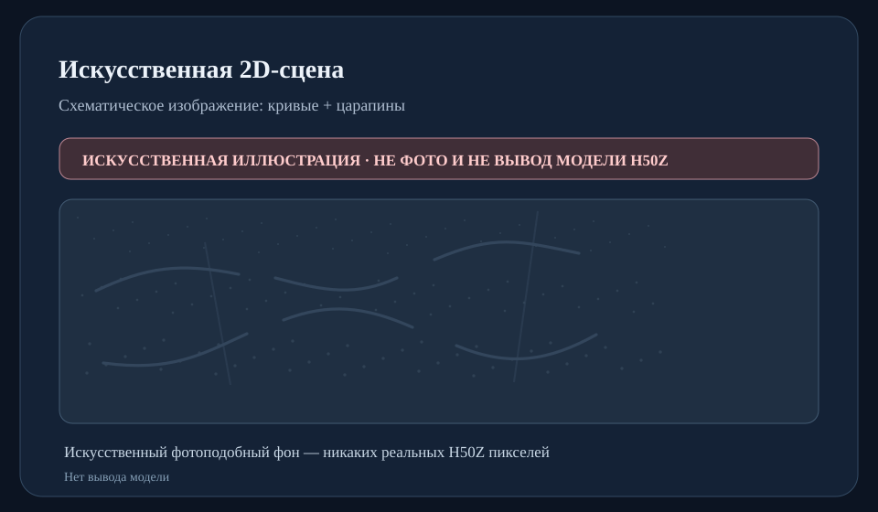
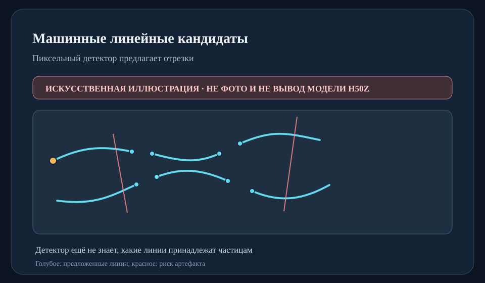
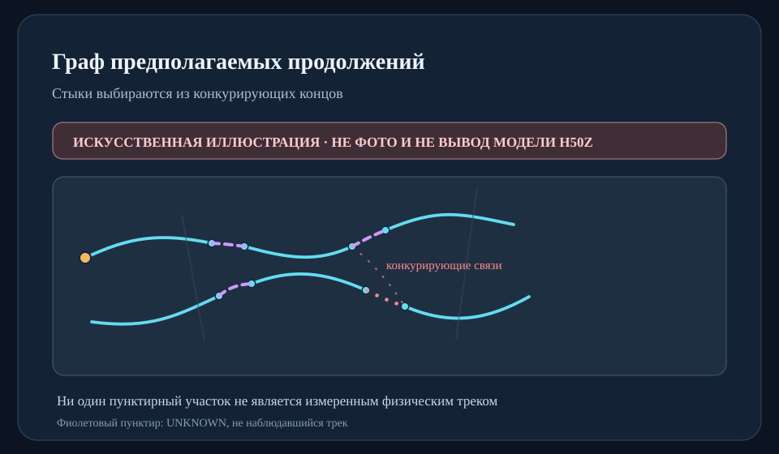
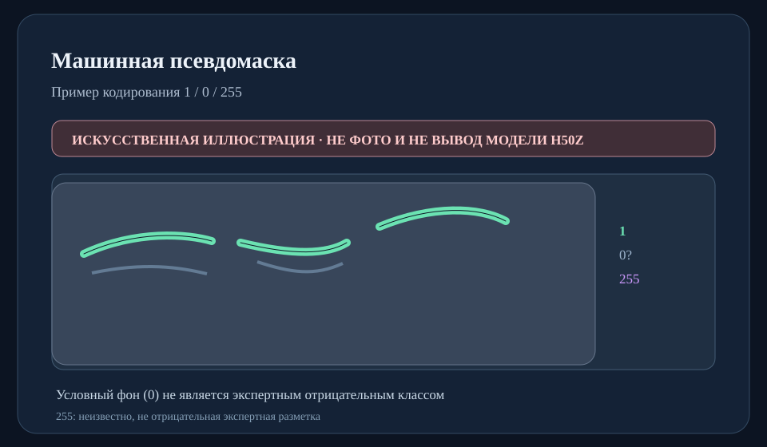

# Материалы ANZA–LIRA для встречи с физиками

**Статус: исследовательские результаты · 29 октября 2026 · read-only / без автоматического соединения физических треков.**

**[Научный отчёт с первичными источниками](../PHYSICISTS_RESULTS_2026_10_29.md)** · [HTML-демонстрация (скачать папку целиком и открыть `demo.html`)](demo.html) · [Машинно-проверяемые результаты](results_manifest.json)

## Что есть сейчас

- **2 настоящих H50Z-фотографии из 1 физического запуска:** 39 выбранных участков 512×512.
- **567 машинных гипотез линий**, после NMS 511 узлов, 182 кандидата соединения, 37 выбранных S56 связей.
- **35 машинных компонентов**: 34 пары и 1 цепочка из четырёх частей. Все имеют статус `UNKNOWN`.
- Сильный **контролируемый синтетический** S28: классическое продолжение линии от известной точки — 96,67% покрытия, 16/16 успешных примеров; не результат по настоящей particle GT.
- **0 экспертно подтверждённых масок и связей; 0 разрешённых автоматических физических объединений**.

## Как выглядят выходы — схемы, НЕ реальные H50Z

## Как получить просмотр на **настоящих** H50Z

Реальные H50Z-пиксели нельзя публиковать без разрешения. В существующих приватных архивах `ANZA_LIRA_S39_PRIVATE_MACHINE_DEMO.zip` и `ANZA_LIRA_S56_S57_PRIVATE_MACHINE_DEMO.zip` есть реальное изображение, наложенные машинные кандидаты, пунктирные мостики, предупреждения и офлайн HTML. Инструкция по повторной сборке и требуемым приватным входам: [проверенный pipeline](../S39_MACHINE_ONLY_RESEARCH_2026_10_25.md), [сборка S57](../S56_S57_MACHINE_GLOBAL_PATH_RESEARCH_2026_10_26.md).

**Нельзя:** выдавать SVG-схемы за реальные снимки, машинные предложения за физические треки, а искусственную GT — за экспертное подтверждение. Без экспертной разметки можно продолжать генерировать предложения; нельзя измерить реальную precision/recall.
